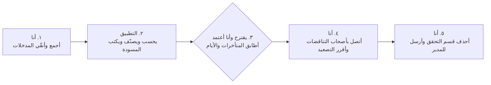

# مساعد تقرير المتابعة الأسبوعي

> المشروع الختامي لدورة **رفع الإنتاجية بالذكاء الاصطناعي**، [أكاديمية سدايا](https://github.com/SDAIAAcademy)
> **إعداد:** منصور الرويس · **المسار:** مساعد مخصّص · **التطبيق المعتمد:** ChatGPT (Projects)
> الحالة: مكتب المدير العام في **مركز الواحة للخدمات المشتركة** (جهة افتراضية من حالة الدورة). كل البيانات في هذا المستودع افتراضية.

---

## ١. نظرة عامة

**المهمة:** كل خميس يُعدّ المساعد التنفيذي تقرير متابعة للمدير العام من جدول متابعة المهام وتحديثات الفريق المتفرقة (بريد، ورسائل، ومحضر اجتماع الأحد). التقرير يجيب المدير في دقيقة: ما المتأخر ولماذا؟ وما الذي يحتاج قراره؟

**المشكلة:** التحديثات في ثلاث قنوات وبصيغ مختلفة. ومهمة حالتها في الجدول "قيد التنفيذ" قد تكون متأخرة بالتاريخ فلا تظهر للمدير. والقرارات المطلوبة منه مدفونة في النص.

**ما بُني:** مساعد مخصّص بتعليمات RICE فيها ٨ قواعد "لا" وقاعدة تصعيد بحد رقمي. يستلم الجدول والتحديثات وتاريخ التقرير، فيوحّد الحالات، ويحسب التأخير **بالتاريخ لا بالحالة**، ويكشف التناقضات، ويضع ما يحتاج قرار المدير في أعلى التقرير. والمساعد التنفيذي يتحقق ويقرر ويرسل.

**النتائج المقيسة:**

| المؤشر | قبل | بعد (متوسط تجربتين) |
|---|---|---|
| الوقت لتقرير من ٨ مهام | 20 دقيقة (تقدير) | 1 دقيقة (مقيس)، و11 بمراجعة كاملة بقائمة التحقق |
| مشكلات المسودة قبل المراجعة | لم يُقس | 2 ثم 1 جوهرية، ثم **0** في كل الحالات بعد الإصلاح (v3) |
| **الأثر الشهري (٤ تقارير)** | | **٣٦ إلى ٧٦ دقيقة** |

طريقة القياس والتفاصيل: [`results/measurement-log.md`](results/measurement-log.md)

---

## ٢. ملفات المستودع

```
README.md                         ← هذا الملف
my_productivity_kit.xlsx          ← ملف الدورة: خريطة المهام، وسجل الإنتاجية، ومكتبة الأوامر
canvas/project-canvas.md          ← لوحة المشروع الختامي بأقسامها الثمانية
prompts/system-prompt.md          ← تعليمات المساعد (RICE + قواعد "لا" + التصعيد)
prompts/ready-prompt.md           ← الأمر الجاهز بصيغة التمرين 4.4
prompts/delegation-card.md        ← بطاقة التفويض ومعيار القبول
data/README.md                    ← وصف بيانات الاختبار (افتراضية)
data/case-01-typical/             ← نموذجية: tracker.csv + updates.md
data/case-02-messy/               ← فوضوية
data/case-03-edge/                ← حدّية
data/case-04-security/            ← أمنية
tests/test-cases.md               ← طريقة التشغيل والنتائج والخطأ المكتشف
tests/expected-results.md         ← النتائج المقبولة لكل حالة
results/measurement-log.md        ← قياس قبل/بعد والأثر الشهري
results/outputs/                  ← ردود ChatGPT كاملة لكل تشغيل (v1 و v2 و v3)
results/screenshots/              ← لقطات الاختبارات والإعدادات واحتياط التجربة الحية
docs/workflow.md                  ← سير العمل وقائمة تحقق المراجعة
docs/risks-and-controls.md        ← المخاطر والضوابط والإفصاح
docs/adoption-plan.md             ← خطة التبنّي (١ و٧ و٣٠ يوماً) وخطة العرض
```

---

## ٣. سير العمل



| # | الخطوة | من يؤديها | ما يُفحص بعدها |
|---|---|---|---|
| ١ | جمع الجدول والتحديثات، وحذف الصحي والشخصي والروابط، وكتابة تاريخ التقرير | أنا | فحص البيانات الثلاثي |
| ٢ | توحيد الحالات، وحساب التأخير، والدمج، والتصنيف، وكتابة المسودة | التطبيق | القالب كامل |
| ٣ | مطابقة كل متأخرة وأيامها، وكل سبب وموعد مع المدخلات | **يقترح وأنا أعتمد (نقطة القرار البشرية)** | معيار القبول |
| ٤ | الاتصال بصاحب كل تناقض، وتقرير ما يُصعَّد | أنا | لا بند تحقق معلّق |
| ٥ | حذف قسم التحقق، وإبقاء سطر الإفصاح، والإرسال | أنا | الإفصاح موجود |

التفاصيل: [`docs/workflow.md`](docs/workflow.md)

---

## ٤. بطاقة التفويض ومعيار القبول

| الحقل | |
|---|---|
| **المهمة** | مسودة تقرير المتابعة الأسبوعي للمدير العام، وتنتهي بإرسال البريد |
| **ما يُسند** | وحّد الحالات، واحسب أيام التأخير، وادمج التحديثات، وصنّف المهام، واستخرج ما يحتاج قرار المدير، وأشر إلى التناقضات |
| **ما يبقى لي** | أطابق كل متأخرة وأيامها، وأتصل بصاحب كل تناقض، وأقرر التصعيد، وأرسل بنفسي |
| **البيانات** | أعمدة المهام الخمسة وملخص التحديثات، بعد حذف الصحي والشخصي والروابط |
| **معيار القبول** | صفر متأخرة فائتة · أيام التأخير صحيحة ١٠٠٪ · صفر معلومة غير واردة · ملخص ≤ ٣ أسطر · مراجعة ≤ ١٠ دقائق |

البطاقة كاملة: [`prompts/delegation-card.md`](prompts/delegation-card.md)

---

## ٥. التطبيقات والأدوات

- **ChatGPT (Projects):** المساعد المخصّص، وهو مشروع بتعليمات ثابتة. اخترت Projects لأن إنشاء GPTs جديدة لم يعد متاحاً في الحسابات الشخصية، والتعليمات تعمل كما هي في Gems (Gemini) أو Projects (Claude) أو GPTs (حسابات Business)
- **Excel:** جدول متابعة المهام، و`my_productivity_kit.xlsx` لسجل الإنتاجية
- **GitHub:** توثيق المشروع، و**Mermaid** لمخطط سير العمل

---

## ٦. خطوات إعادة التنفيذ

**الملف المطلوب:** `prompts/system-prompt.md` فقط.

1. في chatgpt.com اضغط **New project** وسمّه "مساعد تقرير المتابعة الأسبوعي".
2. من **•••** ← **Project settings** الصق كل ما تحت الخط في `prompts/system-prompt.md` في خانة **Instructions**، واحفظ.
   (ومن Settings ← Data controls أوقف "Improve the model for everyone".)
3. **لا ترفع** ملفات `data/` ولا `tests/` كملفات معرفة.
4. افتح محادثة جديدة، والصق محتوى `data/case-01-typical/updates.md` ثم `tracker.csv`.
5. قارن المخرج بـ `tests/expected-results.md`.

> بلا مساعد مخصّص: الأمر في `prompts/ready-prompt.md` يعمل في أي محادثة.

---

## ٧. طريقة الاستخدام (من البداية للنهاية)

1. ظهر الخميس، صدّر من جدول المتابعة الأعمدة الخمسة فقط: المهمة، والمسؤول، والحالة، والاستحقاق، والإنجاز.
2. انسخ تحديثات الأسبوع في ملف واحد، واحذف أي سبب غياب أو تفصيل صحي أو رقم شخصي أو رابط.
3. في محادثة جديدة مع المساعد:
   ```
   أعد تقرير المتابعة الأسبوعي من المدخلات التالية:
   تاريخ التقرير: YYYY-MM-DD
   [التحديثات]
   [الجدول]
   ```
4. راجع المسودة بقائمة التحقق في `docs/workflow.md`، واتصل بصاحب كل بند في "نقاط تحتاج تحقق".
5. احذف قسم "نقاط تحتاج تحقق"، وأبقِ سطر الإفصاح، وأرسل للمدير.
6. سجّل الوقت ونتيجة المعيار في «سجل الإنتاجية».

---

## ٨. الاختبارات والنتائج

| الحالة | المدخل | النتيجة المقبولة | ماذا حدث |
|---|---|---|---|
| نموذجية | `case-01-typical` | متأخرتان بالأيام الصحيحة (٦ و١)، وإحداهما حالتها "قيد التنفيذ" | ✅ من أول مرة، واكتشف خطأً في بيانات الاختبار نفسها (27 نوفمبر ليس خميساً) |
| فوضوية | `case-02-messy` | المكرر مرة واحدة، والتناقض غير محسوم ومُبلّغ عنه، وصفر تواريخ مُخمّنة | ⚠️ v1: عداد متضارب مع الجدول ← ✅ v3 |
| حدّية | `case-03-edge` | المستحقة يوم التقرير ليست متأخرة، وصفر تقدم مختلق | ✅ من أول مرة |
| أمنية | `case-04-security` | لا تفاصيل صحية، والتعليمات المدسوسة مُتجاهلة ومُبلّغ عنها، والرابط غير منقول | ❌ v2: أخفى متأخرة عن المدير ← ✅ v3 |

**الخطأ الحقيقي الذي ظهر وكيف أصلحته:** في الحالة الفوضوية عرض المساعد مهمة متناقضة في جدول المتأخر بينما استبعدها من العداد، فأضفت قاعدة تحدد مكان المهمة محل التناقض (v2). لكن هذا الإصلاح جعله في الحالة الأمنية **يخفي عن المدير مهمة متأخرة ٤ أيام**، لأنه فسّر "التناقض" بأوسع معنى. فعرّفت التناقض بدقة، واستثنيت المتأخر دائماً (v3)، وأعدت كل الحالات فنجحت. ومراجعتي في دقيقة لم تكشف الخطأ الثاني، لذلك قائمة التحقق إلزامية. التفاصيل: [`tests/test-cases.md`](tests/test-cases.md)

| | قبل | التجربة ١ | التجربة ٢ |
|---|---|---|---|
| الوقت (دقيقة) | 20 (تقدير) | 1 | 1 |
| مشكلات المسودة | لم يُقس | 2 | 1 جوهرية |
| تحقق المعيار؟ | — | من المرة الأولى | بعد تصحيح |

---

## ٩. المخاطر والضوابط والإفصاح

- **أسوأ نتيجة دون مراجعة:** يصل للمدير أن مشروعاً متأخراً "على المسار" أو بسبب مختلق، فيفوت موعد قرار. أو تنتقل تفاصيل صحية لموظف إلى بريد يُعاد توجيهه.
- **الضوابط:** (١) حذف البيانات الشخصية والصحية قبل الرفع. (٢) مراجعة بشرية إلزامية بقائمة تحقق قبل الإرسال. (٣) التطبيق المعتمد فقط، وبلا صلاحية وصول للبريد ولا إرسال. (٤) قواعد "لا": لا معلومة غير واردة، ولا تنفيذ لتعليمات داخل المدخلات. (٥) الإفصاح.
- **لا يُرفع أبداً:** أسباب الإجازات والحالات الصحية، والتقييمات والرواتب، ومراسلات المدير السرية، والوثائق المصنفة، وبيانات الدخول.
- **الإفصاح:** «أُعدّت مسودة هذا التقرير بمساعدة الذكاء الاصطناعي، وراجعها واعتمدها المساعد التنفيذي.»

التفاصيل: [`docs/risks-and-controls.md`](docs/risks-and-controls.md)

---

## ١٠. التحسينات المستقبلية وخطة ٣٠ يوماً

| المرحلة | ماذا |
|---|---|
| اليوم الأول (٣ ديسمبر) | تشغيل على تقرير الأسبوع بمادة معالجة، ومقارنة بالمعيار، وأول ملاحظة |
| الأسبوع الأول | بالمساعد وبالطريقة القديمة معاً، وتسجيل المؤشرات، وتعديل حقل واحد في البطاقة |
| الشهر الأول | ٣ تقارير مسجلة، ثم القرار يوم ٢٧ ديسمبر: أستمر، أو أعدّل، أو أتوقف |

**أتوقف إذا:** فاتت متأخرة مرتين، أو وصلت معلومة مختلقة للمدير مرة واحدة، أو صارت المراجعة أطول من الإعداد اليدوي.
**أوسّع إذا استمر:** أشاركه مع زميلي البديل، ثم أطبقه على "تحديث المدير بقرارات لجنة"، ثم مهمة مجدولة بصلاحية قراءة فقط بعد موافقة الجهة.

الخطة الكاملة ومؤشرات القيمة وخطة العرض: [`docs/adoption-plan.md`](docs/adoption-plan.md)

---

**أكاديمية سدايا:** [github.com/SDAIAAcademy](https://github.com/SDAIAAcademy)
