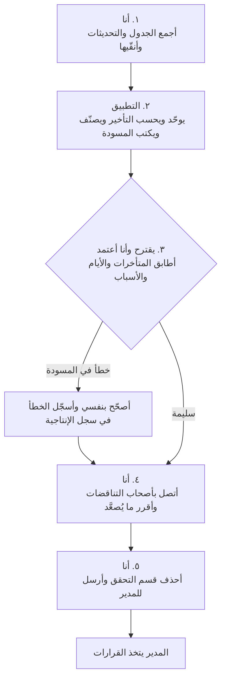

# سير العمل

## الخطوات

| # | الخطوة | من يؤديها | المدخل | المخرج | ما يُفحص بعدها |
|---|---|---|---|---|---|
| ١ | جمع الجدول والتحديثات، وحذف الصحي والشخصي والروابط، وكتابة تاريخ التقرير | **أنا** | جدول المتابعة + البريد + الرسائل + المحضر | مدخلات منقّاة | فحص البيانات الثلاثي |
| ٢ | التوحيد، والحساب، والدمج، والتصنيف، والكتابة | **التطبيق** | المدخلات المنقّاة | مسودة التقرير | القالب كامل |
| ٣ | المطابقة والاعتماد | **يقترح وأنا أعتمد** ⬅️ نقطة القرار البشرية | المسودة | مسودة معتمدة أو مصححة | معيار القبول |
| ٤ | التحقق من التناقضات وقرار التصعيد | **أنا** | "نقاط تحتاج تحقق" | قائمة نهائية لـ "يحتاج قرارك" | لا بند معلّق |
| ٥ | التنظيف والإرسال | **أنا** | التقرير المعتمد | بريد للمدير | الإفصاح موجود |

**أبطأ خطوة بعد التصميم:** الخطوة ١ (جمع التحديثات من ثلاث قنوات). حلها في خطة ٣٠ يوماً: نموذج تحديث أسبوعي موحد للفريق.

## قائمة تحقق الخطوة ٣
- [ ] كل مهمة تاريخها قبل تاريخ التقرير وغير مكتملة ظاهرة في "المتأخر" (أمرّ على عمود التاريخ في الجدول بنفسي)
- [ ] عدد أيام التأخير صحيح لكل مهمة متأخرة
- [ ] المهمة المستحقة يوم التقرير ليست في "المتأخر"
- [ ] كل سبب أو موعد جديد له أصل في التحديثات
- [ ] لا كلمات مثل: مرض، عملية، مستشفى، ظرف عائلي
- [ ] لا روابط في التقرير
- [ ] سطر الإفصاح موجود
